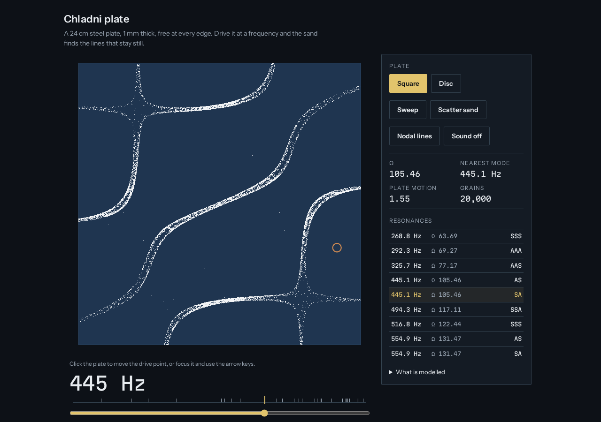

# chladni

Sand on a vibrating plate, computed from plate physics: the modes of free square and circular plates, the plate driven at any frequency, and sand that finds the lines that stay still. A TypeScript library, a browser demo and a short film.



Try it at [speyyman.github.io/chladni/](https://speyyman.github.io/chladni/). The visual essay that uses it is [Sound, made visible](https://speyyman.github.io/media/sound-made-visible/).

## What is in here

| Folder             | What                                                                             |
| ------------------ | -------------------------------------------------------------------------------- |
| `packages/chladni` | The library: plate modes, nodal lines, driven response, sand. No dependencies.   |
| `apps/demo`        | The browser demo, with its own design system ([DESIGN.md](apps/demo/DESIGN.md)). |
| `film`             | The script that renders the film from the library, frame by frame.               |

## Quick start

Needs Node 20 or later.

```sh
npm ci
npm run build                 # library, then the demo into apps/demo/dist
npm run dev -w chladni-demo   # the demo at http://localhost:5173/chladni/
npm test                      # 32 library tests and 6 film tests
npx playwright install chromium && npm run e2e   # end-to-end checks of the demo
```

Using the library:

```ts
import { Bench } from 'chladni'

const bench = new Bench({ shape: 'square' }) // a 24 cm steel plate, 1 mm thick
bench.setHz(bench.resonances[2]!.hz) // drive it at its third resonance
bench.step(400) // let the sand move
;(bench.sand.x, bench.sand.y) // where the grains are, in −1..1
bench.nodalLines() // the still lines, as segments
```

Lower level: `squareModes()`, `circleModes()`, `modeField()`, `nodalLines()`, `drive()`, `Sand`, `hertz()`.

## The physics

**The square plate.** A thin plate (Kirchhoff theory) with all four edges free, the plate Chladni bowed. There is no closed-form solution, so the modes come from the Rayleigh–Ritz method: the deflection is a sum of products of Legendre polynomials, and minimising the ratio of bending energy to kinetic energy gives a matrix eigenproblem, solved in four blocks by symmetry. Ritz himself introduced the method on this problem in 1909. With 16 polynomials per direction the 38 modes below 1,600 Hz are converged to about 1 part in 100,000.

**The disc.** A thin circular plate with a free edge has exact solutions, w = [J_n(λr) + C I_n(λr)] cos nθ, with Bessel functions J and I. The free-edge conditions (no bending moment, no effective shear) give an equation for λ, solved numerically.

**Driving it.** The plate is driven at one point. Each mode responds like a lightly damped oscillator in proportion to how much it moves at that point (standard modal superposition), so a mode with a node at the drive point is not excited at all. The damping ratio, 0.004, is an assumption.

**Sand.** Grains feel the plate's acceleration. Where it is strong they are thrown and land a random distance away; below a threshold they stay put. So they wander out of moving regions and stop on the nodal lines. It is a deliberately simple model: no bouncing dynamics, friction, air currents or grains falling off the edge.

**Hertz.** Frequencies are for a 24 cm square, or a 24 cm disc, of steel 1 mm thick (E = 200 GPa, ρ = 7850 kg/m³, ν = 0.3, typical handbook values), from f = Ω / (2π a²) · √(D / ρh).

## How it is checked

- **Square plate, frequencies.** Compared with Y. Narita, "Natural frequencies of isotropic rectangular plates in improved accuracy", EPI International Journal of Engineering 5 (2022) 26–36, doi:10.25042/epi-ije.022022.05, table 17: the six lowest values for ν = 0.3 (13.468, 19.596, 24.270, 34.801, 34.801, 61.093) and four for ν = 0.333 agree to five significant figures. The doubly symmetric modes agree with A. W. Leissa, _Vibration of Plates_, NASA SP-160 (1969), table 4.65, to 1 part in 10,000, and the twisting modes lie inside Leissa's bounds (table 4.67).
- **A discrepancy in the literature.** Leissa's table 4.65 (after his ref. 4.113) also lists modes at 65.368 and 173.695, and gives one degenerate pair as both 34.8010 and 35.1564, which cannot both be right on a square. Neither this solver nor Narita finds those values (Narita's sixth mode is 61.093). The tests use only values that independent sources agree on.
- **Disc.** Frequencies within 0.2% of Leissa's table 2.5 (ν = 0.33) for every entry the table gives as exact, and nodal-circle radii within 0.005 of table 2.7. A finite-difference check confirms zero bending moment at the rim.
- **Nodal lines.** For the classical membrane approximation cos mπx cos nπy ± cos nπx cos mπy, the extracted nodal lines are checked against their exact zero sets; for the plate, against the lines its symmetry forces (centre lines, diagonals, nodal diameters).
- **Bessel functions** against Abramowitz and Stegun and against mpmath to 1e-12.
- **Demo** (Playwright, `npm run e2e`): no AudioContext exists until the sound switch is pressed; Sweep, the mode list, the slider and the arrow keys work; reduced motion settles the sand at once and turns Sweep into a jump; no horizontal scroll at 375 px; frame rate with the CPU slowed 4×.

## Performance

Measured in headless Chromium on the build machine (`npm run e2e`): 60 fps while sweeping with 20,000 grains. With the CPU slowed 4× it starts at about 30 fps; the demo notices long frames and sheds work, first to one sand step per frame and then to half the grains, and is back to 60 fps with 10,000 grains within a few seconds.

## Limitations

- Kirchhoff thin-plate theory: no shear deformation or rotary inertia, fine for a 1 mm plate at these frequencies.
- The plate is completely free. A real demonstration plate is bolted at its centre or held at a point, which changes its frequencies; that support is not modelled.
- The classical formula cos mπx cos nπy ± cos nπx cos mπy is included for comparison only. It is a membrane approximation, not a plate solution.
- Sand is a statistical caricature of the real bouncing, which also depends on grain size and on air (very fine powder goes to the antinodes instead, as Faraday showed in 1831).
- Hertz figures depend on the assumed steel properties and thickness; the frequency parameters Ω do not.

## References

- W. Ritz, "Theorie der Transversalschwingungen einer quadratischen Platte mit freien Rändern", Annalen der Physik 333 (1909) 737–786, doi:10.1002/andp.19093330403.
- A. W. Leissa, _Vibration of Plates_, NASA SP-160, 1969, https://ntrs.nasa.gov/citations/19700009156.
- M. D. Waller, "Vibrations of free square plates: part I. Normal vibrating modes", Proceedings of the Physical Society 51 (1939) 831–844, doi:10.1088/0959-5309/51/5/312.
- Y. Narita, EPI International Journal of Engineering 5 (2022) 26–36, doi:10.25042/epi-ije.022022.05.
- M. Faraday, "On a peculiar class of acoustical figures; and on certain forms assumed by groups of particles upon vibrating elastic surfaces", Philosophical Transactions of the Royal Society 121 (1831) 299–340, doi:10.1098/rstl.1831.0018.

## Licence

Code: MIT, see [LICENSE](LICENSE). The film and its stills: CC BY 4.0. Fonts (Instrument Sans, Martian Mono): SIL Open Font License 1.1, see [CREDITS.md](CREDITS.md).

The code was written with Claude, an AI assistant, under the author's direction.
